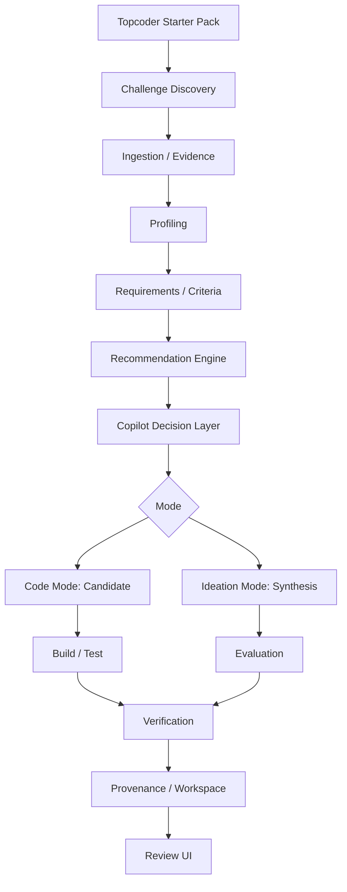

# Topcoder Combinator

Topcoder Combinator helps reviewers combine the strongest parts of Topcoder
submissions without losing the evidence, decisions, or verification behind the
result.

## Problem

Strong submissions often optimize different dimensions: one may have the best
implementation, another the clearest user experience, and another the most
complete documentation. Combining them manually is difficult because reviewers
must compare heterogeneous evidence, preserve source attribution, avoid unsafe
copying, and explain why a final choice was made.

## Solution

The Combinator ingests a challenge starter pack, profiles each submission,
extracts evidence, and maps that evidence to requirements or evaluation
criteria. Its recommendation layer proposes candidates and alternatives.
Copilot decisions remain authoritative: accepted, rejected, alternative,
blocked, and manual-review states are persisted rather than silently replaced.
Candidate or synthesized outputs are then verified and written with provenance,
contradictions, source locations, and deterministic workspace metadata.

The product message is:

> **AI recommends. Copilot decides. Verification proves.**

## Modes

### Code Mode

Code Mode:

1. Selects a base submission using the requirement evidence.
2. Selects compatible transplants from other submissions.
3. Creates an isolated candidate workspace.
4. Verifies the candidate with the configured build/test checks.
5. Publishes a combined solution only when the candidate succeeds.

Ties and unresolved decisions remain visible for manual review; failed
candidates are never presented as successful.

### Ideation Mode

Ideation Mode:

1. Extracts ideas and evidence from submissions.
2. Evaluates ideas across multiple criteria.
3. Produces recommendations and alternatives.
4. Preserves Copilot decisions, including unresolved ties.
5. Synthesizes one coherent concept from accepted decisions.
6. Verifies synthesis consistency and records its evidence links.

The system does not silently select a winner when a criterion is tied.

## Architecture



At runtime the frontend calls the FastAPI backend. The backend orchestrates
discovery, profiling, evidence, recommendations, decisions, candidate or
synthesis generation, verification, and workspace persistence.

## Safety and integrity

- Starter-pack sources and copied source submissions are treated as immutable
  inputs.
- Candidate writes are restricted to the generated `workspace/` tree.
- Workspace path resolution rejects traversal outside the intended challenge
  directory.
- Symlinked source content is rejected before copying.
- Candidate workspaces are isolated from source submissions.
- Provenance and source-location artifacts link material claims back to source
  evidence without fabricating unreliable locations.
- Contradictions remain recorded instead of treating reviewer comments as
  unquestionable ground truth.
- API keys are not exposed to the frontend.

## Reproducibility

Processing is deterministic where the source evidence and decisions are
unchanged. Generated IDs, workspace metadata, recommendations, and verification
artifacts avoid timestamps and random values that would make reruns unstable.
Persisted Copilot decisions are loaded and reconciled with current
recommendations, while explicit decisions remain authoritative. Recommendation
ties stay unresolved until Copilot selects an alternative.

## Running locally

Start the backend:

```bash
cd backend
uvicorn app.main:app --reload
```

Start the frontend in another terminal:

```bash
cd frontend
npm run dev
```

Open the Vite URL and select a challenge. The dashboard exposes evidence,
requirements or criteria, Copilot decisions, and the Verify panel.

## 3-5 minute hackathon demo

1. Open the dashboard.
2. Select a Code Mode challenge.
3. Inspect submission evidence.
4. Open the requirement matrix.
5. Show the Copilot recommendation.
6. Accept or select a decision.
7. Show the generated candidate or combined solution.
8. Open Verify and show build/test status.
9. Inspect provenance and source locations.
10. Switch to Ideation Mode.
11. Show the extracted ideas.
12. Show recommendations for each criterion.
13. Highlight a tie requiring Copilot selection.
14. Explain that the system does not silently choose a winner.
15. Show the unresolved state, synthesis evidence, and provenance in Verify.

Use the Deal Scoping challenge to demonstrate a deterministic Code Mode
manual-review blocker. Use Community Enablement SDLC to demonstrate Ideation
ties and the intentionally unresolved synthesis state.

## Validation status

The current validated implementation has:

- **Backend:** 120 tests passing.
- **Frontend:** production build passing with `npm run build`.
- **Challenge APIs:** all four challenge flows return HTTP 200.
- **Successful Code Mode candidates:** `AI_LEARNING_ADVENTURE` and
  `AI_WORKFLOW_PUZZLE_BUILDER`.
- **Intentional Code Mode manual review:** `AI_DEAL_SCOPING_ASSISTANT` has a
  deterministic base-selection tie and no successful combined solution.
- **Ideation Mode:** `AGENTIC_AI_COMMUNITY_ENABLEMENT_SDLC` has generated ideas,
  evaluation, recommendations, synthesis, provenance, contradictions, and
  verification while preserving unresolved recommendation ties.

The generated workspaces contain the machine-readable manifest, review-context
artifacts, source-location map, decisions, provenance, contradictions,
verification, and review UI metadata. Successful Code Mode workspaces also
contain `combined-solution/`; the Ideation workspace contains
`synthesized-concept/`.
