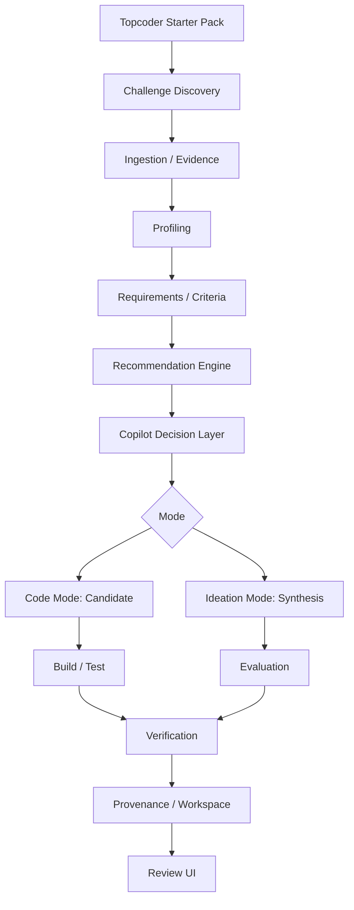

# Topcoder Combinator

Topcoder Combinator helps reviewers combine the strongest parts of Topcoder
submissions without losing the evidence, decisions, or verification behind the
result.

## Problem

Strong submissions often optimize different dimensions: one may have the best
implementation, another the clearest user experience, and another the most
complete documentation. Combining them manually is difficult because reviewers
must compare heterogeneous evidence, preserve source attribution, avoid unsafe
copying, and explain why a final choice was made.

## Solution

The Combinator ingests a challenge starter pack, profiles each submission,
extracts evidence, and maps that evidence to requirements or evaluation
criteria. Its recommendation layer proposes candidates and alternatives.
Copilot decisions remain authoritative: accepted, rejected, alternative,
blocked, and manual-review states are persisted rather than silently replaced.
Candidate or synthesized outputs are then verified and written with provenance,
contradictions, source locations, and deterministic workspace metadata.

The product message is:

> **AI recommends. Copilot decides. Verification proves.**

## Modes

### Code Mode

Code Mode:

1. Selects a base submission using the requirement evidence.
2. Selects compatible transplants from other submissions.
3. Creates an isolated candidate workspace.
4. Verifies the candidate with the configured build/test checks.
5. Publishes a combined solution only when the candidate succeeds.

Ties and unresolved decisions remain visible for manual review; failed
candidates are never presented as successful.

### Ideation Mode

Ideation Mode:

1. Extracts ideas and evidence from submissions.
2. Evaluates ideas across multiple criteria.
3. Produces recommendations and alternatives.
4. Preserves Copilot decisions, including unresolved ties.
5. Synthesizes one coherent concept from accepted decisions.
6. Verifies synthesis consistency and records its evidence links.

The system does not silently select a winner when a criterion is tied.

## Architecture



At runtime the frontend calls the FastAPI backend. The backend orchestrates
discovery, profiling, evidence, recommendations, decisions, candidate or
synthesis generation, verification, and workspace persistence.

## Safety and integrity

- Starter-pack sources and copied source submissions are treated as immutable
  inputs.
- Candidate writes are restricted to the generated `workspace/` tree.
- Workspace path resolution rejects traversal outside the intended challenge
  directory.
- Symlinked source content is rejected before copying.
- Candidate workspaces are isolated from source submissions.
- Provenance and source-location artifacts link material claims back to source
  evidence without fabricating unreliable locations.
- Contradictions remain recorded instead of treating reviewer comments as
  unquestionable ground truth.
- API keys are not exposed to the frontend.

## Reproducibility

Processing is deterministic where the source evidence and decisions are
unchanged. Generated IDs, workspace metadata, recommendations, and verification
artifacts avoid timestamps and random values that would make reruns unstable.
Persisted Copilot decisions are loaded and reconciled with current
recommendations, while explicit decisions remain authoritative. Recommendation
ties stay unresolved until Copilot selects an alternative.

## Evidence, provenance, and workspace artifacts

Evidence is registered with stable IDs and linked to source paths, pages,
sections, tables, figures, or content blocks when extraction provides a
reliable location. Recommendations reference that evidence, decisions record
the Copilot state and reviewer, and provenance records the recommendation and
decision lineage. Contradictions are retained instead of being silently
discarded.

Each generated `workspace/<challenge-id>/` contains the manifest, copied
read-only submissions, review-context reconciliation, source-location map,
requirements or ideas, recommendations, decisions, provenance,
contradictions, verification, `llm-usage.json`, and `review-ui/` metadata.
Successful Code Mode runs additionally contain `combined-solution/`.
Ideation runs contain `synthesized-concept/`.

## Provider adapter and AI execution

The optional provider boundary is:

```text
ChallengeOrchestrator
        |
        v
      LLMProvider
      /       \
 MockProvider  BedrockProvider
```

Provider-specific calls are isolated in `backend/app/llm/`. The supplied
recommendation and evidence pipelines are deterministic and do not require an
LLM call for the included workflow, so the default mock usage report honestly
shows zero calls when a workspace is generated. The adapter is available for
optional semantic enrichment without putting provider calls in business logic.

Supported providers:

- `mock`: offline, deterministic, no credentials, no network, zero cost.
- `bedrock`: Amazon Bedrock Runtime Converse through the isolated adapter.

For Bedrock, use the standard AWS credential chain and configure:

```bash
LLM_PROVIDER=bedrock
AWS_REGION=us-east-1
BEDROCK_MODEL_ID=<provider-supported-model-id>
LLM_ENDPOINT_URL=
LLM_TIMEOUT_SECONDS=30
LLM_MAX_RETRIES=0
LLM_TEMPERATURE=0
LLM_MAX_TOKENS=1024
```

Credentials are never required for mock mode and are never sent to the
frontend. The Bedrock adapter does not invent token counts or prices. When a
provider omits usage data, `llm-usage.json` records token fields as `null`;
when pricing is unavailable, `approximateCost` is also `null`.

The usage artifact reports:

```json
{
  "provider": "mock",
  "model": "deterministic-mock",
  "calls": 0,
  "inputTokens": null,
  "outputTokens": null,
  "totalTokens": null,
  "approximateCost": 0.0,
  "retries": 0,
  "failures": 0,
  "processingTimeMs": 0
}
```

The Verify panel displays the provider, model, call count, tokens, and cost
availability.

## Running locally

From a fresh checkout:

Create the backend environment and install dependencies:

```bash
cd backend
python3 -m venv .venv
.venv/bin/python -m pip install -r requirements.txt
```

Start the backend:

```bash
cd backend
.venv/bin/uvicorn app.main:app --reload
```

Check health and challenge discovery:

```bash
curl http://127.0.0.1:8000/health
curl http://127.0.0.1:8000/api/challenges
```

Start the frontend in another terminal:

```bash
cd frontend
npm ci
npm run dev
```

For an offline deterministic run, keep the root `.env` or environment set to:

```bash
COMBINATOR_AI_MODE=mock
LLM_PROVIDER=mock
```

`LLM_PROVIDER=mock` is the active provider switch. `COMBINATOR_AI_MODE` is
accepted as the demo-facing name for local workflows; the current settings
default remains mock when no provider is configured.

Generate or refresh a challenge workspace through the dashboard/API. The
backend writes only below `workspace/` and never changes `starter-pack/`.

Run the backend tests:

```bash
cd backend
.venv/bin/pytest -q
```

Build the frontend:

```bash
cd frontend
npm run build
```

The browser talks only to the local FastAPI API. No provider secret is stored
in React state, browser storage, Vite client variables, or browser bundles.

## Security model

- Source submissions and starter-pack fixtures are immutable inputs.
- Candidate writes are confined to `workspace/<challenge-id>/`.
- Canonical path resolution rejects traversal and symlink components.
- Symlinked source trees and files are rejected before copying.
- Verification commands run only from the configured challenge verification
  data and inside bounded candidate directories.
- DOCX extraction reads text and tables only. Office packages containing
  VBA projects, OLE embeddings, ActiveX parts, or custom UI active content
  are rejected; no macros or embedded executables are run.
- PDF extraction reads page text through PyMuPDF and does not execute PDF
  actions or scripts.
- Provider credentials remain server-side and use the standard AWS credential
  chain for Bedrock.

## Generality and known limitations

Challenge discovery reads the starter-pack inventory rather than hard-coding
challenge IDs, submission IDs, winners, or requirement IDs. Requirement
matrices, scorecards, repository paths, verification commands, submission
counts, and source locations are derived from each challenge's context and
scanned files. The profilers support repository trees plus PDF, DOCX, PNG,
JPG, and JPEG submission evidence.

The current extraction boundary does not include PPTX parsing, arbitrary
binary document formats, or executing arbitrary project-specific dependency
installers. Verification commands are fixture/configuration supplied and
remain subject to the challenge's declared runtime. These are explicit
limitations rather than claims of universal stack or document support.
uvicorn app.main:app --reload
```

Start the frontend in another terminal:

```bash
cd frontend
npm run dev
```

Open the Vite URL and select a challenge. The dashboard exposes evidence,
requirements or criteria, Copilot decisions, and the Verify panel.


## Validation status

The current validated implementation has:

- **Backend:** 120 tests passing.
- **Frontend:** production build passing with `npm run build`.
- **Challenge APIs:** all four challenge flows return HTTP 200.
- **Successful Code Mode candidates:** `AI_LEARNING_ADVENTURE` and
  `AI_WORKFLOW_PUZZLE_BUILDER`.
- **Intentional Code Mode manual review:** `AI_DEAL_SCOPING_ASSISTANT` has a
  deterministic base-selection tie and no successful combined solution.
- **Ideation Mode:** `AGENTIC_AI_COMMUNITY_ENABLEMENT_SDLC` has generated ideas,
  evaluation, recommendations, synthesis, provenance, contradictions, and
  verification while preserving unresolved recommendation ties.

The generated workspaces contain the machine-readable manifest, review-context
artifacts, source-location map, decisions, provenance, contradictions,
verification, and review UI metadata. Successful Code Mode workspaces also
contain `combined-solution/`; the Ideation workspace contains
`synthesized-concept/`.
